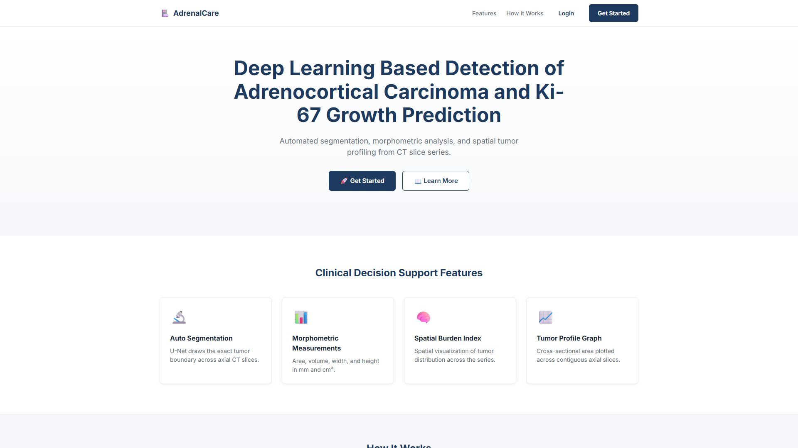
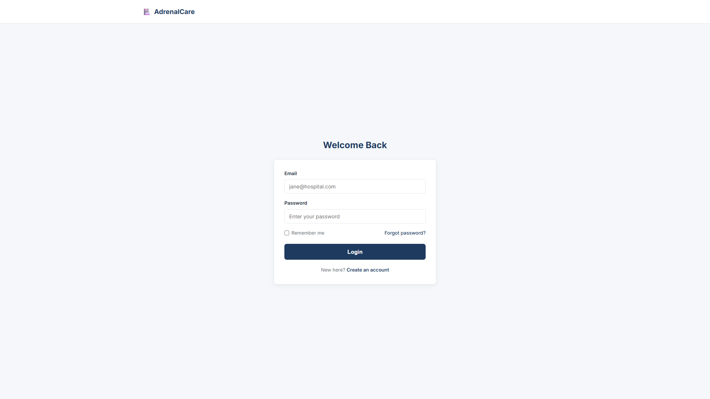
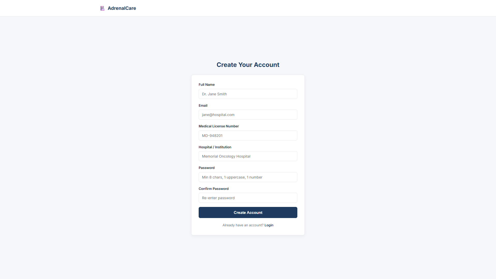
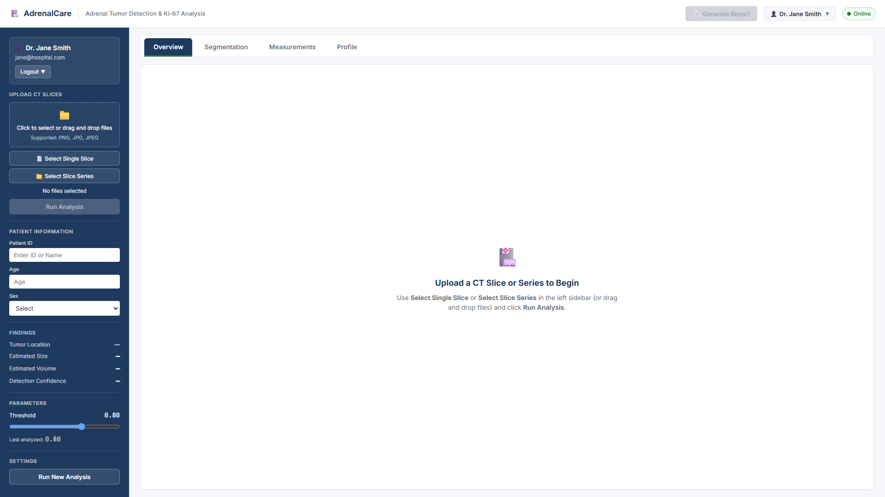
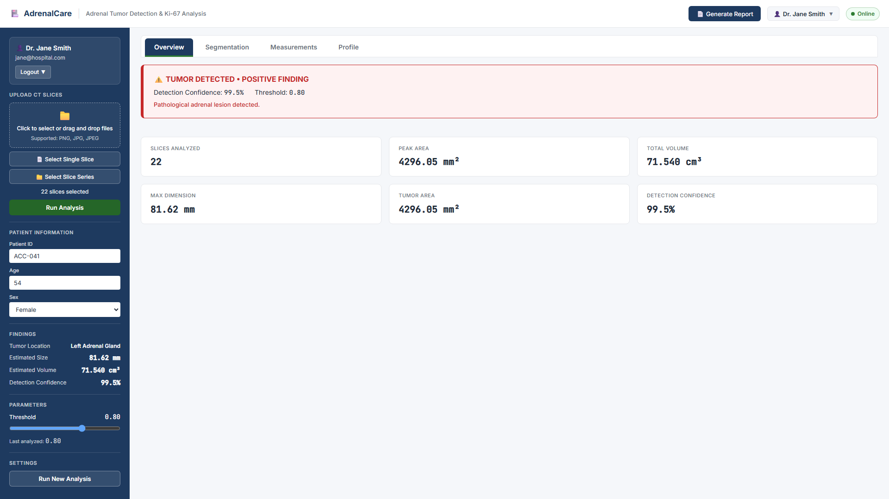
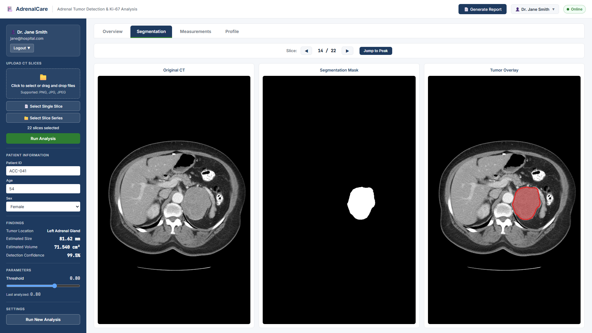
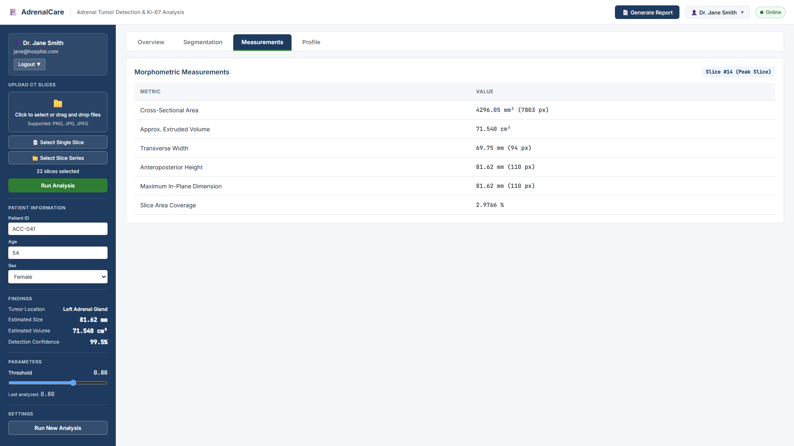
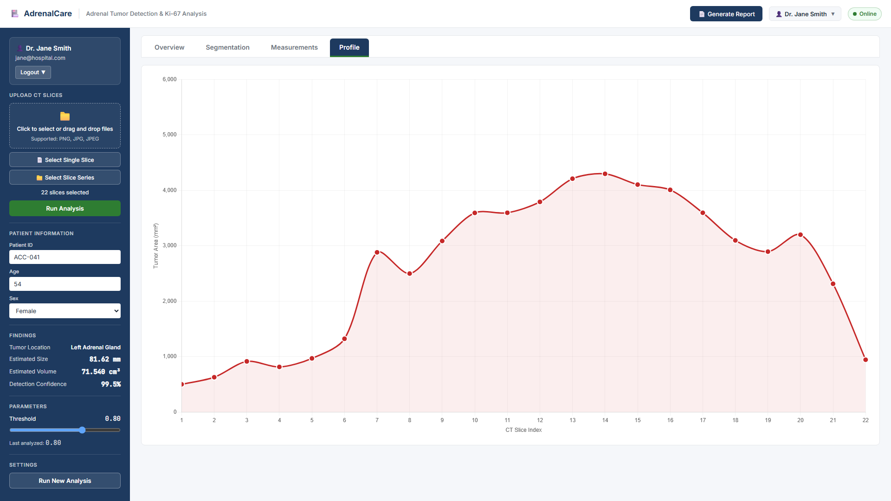
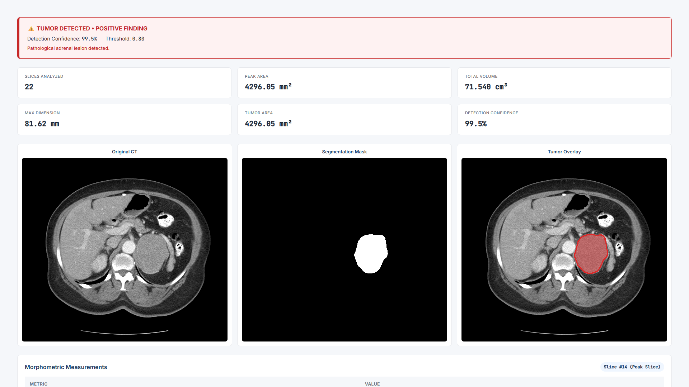

# Adrenal Tumor Detection

A deep learning based clinical decision support system for automated detection 
and morphometric analysis of Adrenocortical Carcinoma (ACC) from CT slice series.


---

## Overview

Adrenal Tumor Detection is a web-based system that performs automated adrenal 
tumor segmentation and morphometric analysis from CT slice series. It uses a 
U-Net deep learning model to segment adrenal tumors and computes clinical 
measurements including cross-sectional area, tumor volume, and spatial 
distribution across slices.

The system provides clinicians with:
- Automated tumor detection and segmentation
- Morphometric measurements (area, volume, dimensions)
- Cross-sectional tumor profile across CT slices
- Printable clinical reports

---

## Features

| Feature | Description |
|---------|-------------|
| 🔬 Automated Segmentation | U-Net based pixel-precise tumor boundary detection |
| 📐 Morphometric Analysis | Cross-sectional area, volume, transverse width, anteroposterior height |
| 📈 Spatial Distribution | Tumor area profile across CT slice series |
| 📄 Clinical Report | Printable PDF report of analysis |
| 🔐 Multi-user Support | Clinician registration and login |
| 🧑 Patient Management | Store patient ID, age, and sex per analysis |

---

## Tech Stack

| Layer | Technology |
|-------|------------|
| Backend | Python 3.8+, Flask |
| Deep Learning | TensorFlow 2.x, Keras |
| Image Processing | OpenCV, pydicom, SimpleITK |
| Frontend | HTML5, CSS3, JavaScript |
| Charts | Chart.js |
| Database | SQLite (development) |
| Deployment | Ubuntu 20.04 LTS, Gunicorn, Nginx |

---

## Dataset

The model is trained on the **Adrenal-ACC-Ki67-Seg** dataset from The Cancer 
Imaging Archive (TCIA).

| Attribute | Value |
|-----------|-------|
| Source | The Cancer Imaging Archive (TCIA) |
| Patients | 53 confirmed ACC cases |
| Total Slices | 18,255 |
| Modality | Contrast-enhanced CT |
| License | CC BY 4.0 |

**Citation:**

> Moawad, A. W., Ahmed, A. A., ElMohr, M., Eltaher, M., Habra, M. A., Fisher, S., 
> Perrier, N., Zhang, M., Fuentes, D., & Elsayes, K. (2023). Voxel-level segmentation 
> of pathologically-proven Adrenocortical carcinoma with Ki-67 expression 
> (Adrenal-ACC-Ki67-Seg) [Data set]. The Cancer Imaging Archive. 
> https://doi.org/10.7937/1FPG-VM46

---

## Screenshots

### Landing Page


### Login


### Register


### Dashboard — Empty State


### Upload Panel


### Overview Tab


### Segmentation Tab


### Measurements Tab


### Profile Graph


### Printable Clinical Report


---

## Project Structure

```text
adrenal-tumor-detection/
├── app.py                              # Flask application, auth routes, and /api/analyze endpoint
├── inference.py                        # 3-layer CT image validation & morphometric helpers
├── prepare_test_data.py                # Utility to extract sample CT series for testing
├── requirements.txt                    # Python dependencies
├── users.db                            # SQLite clinician authentication database
├── models/
│   └── tumor_focused_resume_training_v2/
│       └── best_model.keras            # Trained U-Net segmentation model (512x512x1)
├── templates/
│   ├── landing.html                    # Public landing page
│   ├── login.html                      # Clinician login page
│   ├── register.html                   # Clinician registration page
│   ├── dashboard.html                  # Protected clinical analysis dashboard
│   ├── profile.html                    # Clinician profile management
│   └── settings.html                   # Application & parameter settings
├── static/
│   ├── css/
│   │   └── style.css                   # Clinical design system & print media styles
│   ├── js/
│   │   └── app.js                      # Upload controller, 4-tab navigation & Chart.js profile
│   └── masks/                          # Generated CT slice masks & red contour overlays
├── test_data/
│   └── patient_041/                    # Sample 22-slice axial CT series (slice_001.png - slice_022.png)
└── screenshots/                        # Full HD (1920x1080) UI screenshots
```

---

## Installation Steps

### Prerequisites
- **Python 3.8+**
- **pip** (Python package manager)
- **Git**

### 1. Clone the Repository
```bash
git clone https://github.com/sakshi983-gf/adrenal-tumor-detection.git
cd adrenal-tumor-detection
```

### 2. Create and Activate a Virtual Environment
```bash
# Windows (PowerShell)
python -m venv .venv
.\.venv\Scripts\Activate.ps1

# Linux / macOS
python3 -m venv .venv
source .venv/bin/activate
```

### 3. Install Dependencies
```bash
pip install -r requirements.txt
```

### 4. Run the Application
```bash
python app.py
```
The server starts at **`http://127.0.0.1:5000`**.

---

## Usage Walkthrough

1. **Launch & Sign In**
   - Open `http://127.0.0.1:5000` in your browser.
   - Click **Login** (or **Create Account** to register a new clinician profile).
   - Default demo clinician credentials:
     - **Email:** `jane@hospital.com`
     - **Password:** `Password123`

2. **Upload CT Slices**
   - In the left sidebar under **Upload CT Slices**, choose either:
     - **📄 Select Single Slice** to analyze an individual axial CT image (`.png`, `.jpg`, `.jpeg`), or
     - **📁 Select Slice Series** to upload an entire folder of axial CT slices (e.g., `test_data/patient_041/`).
   - Optionally enter **Patient ID**, **Age**, and **Sex** under **Patient Information**.

3. **Run Analysis**
   - Click **Run Analysis**. The system performs 3-layer CT image validation (file format check, grayscale/dimension/HU histogram check, and axial abdominal CT region check) before running U-Net segmentation.

4. **Explore Results Across 4 Tabs**
   - **Overview Tab:** Displays positive/negative tumor detection status, confidence score, and a 3×2 summary grid (*Slices Analyzed*, *Peak Area*, *Total Volume*, *Max Dimension*, *Tumor Area*, *Confidence*).
   - **Segmentation Tab:** Interactive slice navigator (`◀ Prev`, `Next ▶`, `Jump to Peak Slice`) with a 3-panel viewer (*Original CT*, *Predicted Mask*, *Tumor Overlay*).
   - **Measurements Tab:** Detailed morphometric table for the active slice in both physical units (`mm`, `mm²`, `cm³`) and pixels (`px`).
   - **Profile Tab:** Chart.js cross-sectional tumor area curve (`mm²`) plotted across 1-based CT slice indices.

5. **Generate Clinical Report**
   - Click **📄 Generate Report** in the top-right header to open the print-formatted clinical report (`window.print()`) for PDF export or printing.

---

## Model Architecture

The segmentation engine uses an encoder–decoder **U-Net** architecture tailored for `512 × 512 × 1` axial abdominal CT slices:

| Component | Specification |
|-----------|---------------|
| **Architecture** | 2D Convolutional U-Net with Skip Connections |
| **Input Tensor** | `512 × 512 × 1` (grayscale CT normalized to `[0, 1]`) |
| **Encoder Path** | 4 downsampling blocks (`Conv2D 3×3` → `BatchNorm` → `ReLU` → `MaxPool2D 2×2`) |
| **Bottleneck** | Deep feature representation bridge with dropout regularization |
| **Decoder Path** | 4 upsampling blocks (`Conv2DTranspose` + skip concatenation + `Conv2D 3×3`) |
| **Output Layer** | `1 × 1 Conv2D` with `Sigmoid` activation (`512 × 512 × 1` probability map) |
| **Loss Function** | Combined Dice Loss + Binary Cross-Entropy (BCE) |
| **Post-Processing** | Probability thresholding (`default = 0.80`), largest connected-component filtering (`≥ 150 px`), and binary hole filling |
| **Total Parameters** | `1,946,705` (lightweight tumor-focused U-Net checkpoint) |

---

## Output Metrics

### Morphometric & Volumetric Calculations
Using calibrated CT spatial geometry (`pixel_spacing = 0.742 mm`, `slice_thickness = 1.25 mm`):

| Metric | Formula / Definition | Unit |
|--------|----------------------|------|
| **Cross-Sectional Area** | $N_{\text{pixels}} \times (0.742\text{ mm})^2$ | $\text{mm}^2, \text{px}$ |
| **Total Tumor Volume** | $\sum_{i=1}^{N} \text{Area}_i \times 1.25\text{ mm} / 1000$ | $\text{cm}^3$ |
| **Transverse Width** | $(x_{\max} - x_{\min} + 1) \times 0.742\text{ mm}$ | $\text{mm}, \text{px}$ |
| **Anteroposterior Height** | $(y_{\max} - y_{\min} + 1) \times 0.742\text{ mm}$ | $\text{mm}, \text{px}$ |
| **Max Bounding Dimension** | $\max(\text{Width}, \text{Height})$ | $\text{mm}, \text{px}$ |
| **Slice Coverage** | $(N_{\text{pixels}} / (512 \times 512)) \times 100$ | $\%$ |

### Held-Out Test Set Evaluation (295 Unseen Slices across 9 Patients)
| Evaluation Metric | Score (Threshold = 0.80) |
|-------------------|--------------------------|
| **Image-Level Sensitivity (Recall)** | `92.55%` |
| **Image-Level Precision** | `89.39%` |
| **Image-Level F1-Score** | `90.94%` |
| **Image-Level Accuracy** | `84.07%` |
| **Mean Dice Coefficient (Tumor Slices)** | `57.31%` |
| **Mean IoU (Tumor Slices)** | `50.74%` |
| **Peak Single-Slice Dice Score** | `95.94%` |

---

## Limitations

1. **Research Prototype Only:** This software is designed for academic research and educational demonstration. It is **not** FDA-cleared or CE-marked and must not be used for primary clinical diagnosis.
2. **2D Slice-Wise Inference:** Each axial slice is segmented in 2D (`512 × 512`) rather than full 3D volumetric context, which can cause false positives on adjacent soft-tissue structures in negative slices.
3. **Fixed Calibration Fallback:** When PNG/JPG slices are uploaded without embedded DICOM tags, physical measurements use a calibrated abdominal CT spacing (`0.742 mm/px` and `1.25 mm` slice thickness).
4. **Modality Specificity:** Trained exclusively on contrast-enhanced abdominal CT scans of pathologically confirmed Adrenocortical Carcinoma (ACC); performance on MRI, non-contrast CT, or benign adrenal adenomas is not guaranteed.

---

## Team and Acknowledgments

- **Developer & Researcher:** Sakshi ([`@sakshi983-gf`](https://github.com/sakshi983-gf))
- **Acknowledgments:**
  - **The Cancer Imaging Archive (TCIA)** and the authors of the *Adrenal-ACC-Ki67-Seg* dataset at MD Anderson Cancer Center for making high-quality annotated Adrenocortical Carcinoma CT volumes publicly available.
  - Open-source maintainers of TensorFlow, Keras, Flask, OpenCV, SimpleITK, pydicom, and Chart.js.

---

## License

This project is licensed under the **MIT License**.

Dataset annotations and imaging from the TCIA **Adrenal-ACC-Ki67-Seg** collection are governed by the [Creative Commons Attribution 4.0 International License (CC BY 4.0)](https://creativecommons.org/licenses/by/4.0/).

---

## References

1. Moawad, A. W., Ahmed, A. A., ElMohr, M., Eltaher, M., Habra, M. A., Fisher, S., Perrier, N., Zhang, M., Fuentes, D., & Elsayes, K. (2023). *Voxel-level segmentation of pathologically-proven Adrenocortical carcinoma with Ki-67 expression (Adrenal-ACC-Ki67-Seg)* [Data set]. The Cancer Imaging Archive. https://doi.org/10.7937/1FPG-VM46
2. Ronneberger, O., Fischer, P., & Brox, T. (2015). *U-Net: Convolutional Networks for Biomedical Image Segmentation*. Medical Image Computing and Computer-Assisted Intervention (MICCAI), LNCS, vol. 9351, pp. 234–241. https://doi.org/10.1007/978-3-319-24574-4_28
3. Clark, K., Vendt, B., Smith, K., Freymann, J., Kirby, J., Koppel, P., Moore, S., Phillips, S., Maffitt, D., Pringle, M., Tarbox, L., & Prior, F. (2013). *The Cancer Imaging Archive (TCIA): Maintaining and Operating a Public Information Repository*. Journal of Digital Imaging, 26(6), 1045–1057. https://doi.org/10.1007/s10278-013-9622-7
